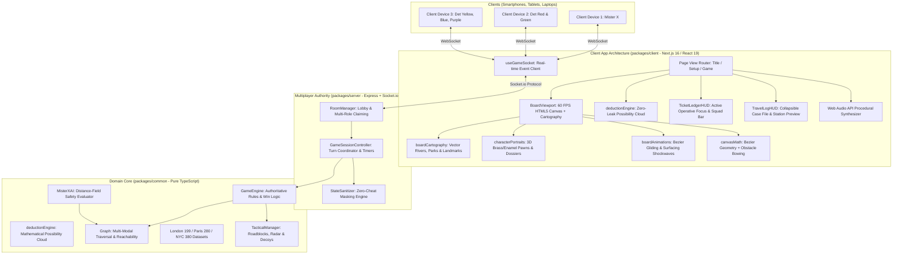

# CURRENT ARCHITECTURE AND STATUS

> **Authoritative Context Document for AI Assistants & Developers**  
> *Last Updated: October 2026*  
> **Status**: Production-Ready Prototype (43/43 Unit & Integration Tests Passing • ESLint & TypeScript Strict Clean • Next.js 16 Webpack Build Clean)

---

## 1. Executive Summary & Architecture Overview

**Digital Scotland Yard** is a tactical, real-time, multi-device web adaptation of the classic Ravensburger deduction board game. Players take on the roles of the fugitive **Mister X** and 5 detectives (**Red CID, Green Yard, Yellow Branch, Blue Squad, Purple Interpol**).

### High-Level Architectural Flow

---

## 2. Exhaustive File-by-File Catalog

### 2.1 Monorepo Root Configuration Files

#### `package.json`
- **Path**: `/package.json`
- **Purpose**: Defines root npm workspaces (`packages/*`), global scripts, and monorepo devDependencies.
- **Exports/Scripts**:
  - `npm test`: Runs test suites across all workspaces (`packages/common` and `packages/server`).
  - `npm run test:common`: Runs `packages/common` unit tests via Node.js native test runner.
  - `npm run test:server`: Runs `packages/server` unit and Socket.io integration tests via Node.js native test runner.
  - `npm run lint`: Runs ESLint 9 across `packages/` enforcing Node 26 strip-types rules (`@typescript-eslint/consistent-type-imports`, no parameter properties/enums) and React hooks rules.
  - `npm run typecheck`: Runs `tsc --noEmit` across `common`, `server`, and `client`.
  - `npm run build:client`: Compiles the Next.js client production bundle with Webpack.
  - `npm run dev:client`: Runs Next.js local development server (`:3000`).
  - `npm run dev:server`: Runs Node.js Socket.io server with `--experimental-strip-types` (`:3001`).
- **Dependencies**: Workspace definitions for `packages/client`, `packages/common`, `packages/server`.

#### `eslint.config.mjs` & `.github/workflows/ci.yml`
- **Paths**: `/eslint.config.mjs`, `/.github/workflows/ci.yml`
- **Purpose**: Flat ESLint 9 configuration enforcing Node 26 `--experimental-strip-types` syntax rules and GitHub Actions CI pipeline running `lint`, `typecheck`, `test`, and `build:client`.

#### `tsconfig.base.json`
- **Path**: `/tsconfig.base.json`
- **Purpose**: Base TypeScript compiler settings shared across packages (`target: ES2022`, `moduleResolution: Bundler`, `strict: true`).

#### `.env.example`
- **Path**: `/.env.example`
- **Purpose**: Documents optional environment variables for client and server (`NEXT_PUBLIC_SERVER_URL`, `ALLOWED_DEV_ORIGINS`, `PORT`, `HOST`, `CORS_ORIGIN`, `RECONNECT_GRACE_MS`). All variables have zero-config defaults.

---

### 2.2 `packages/common` (Pure Game Logic, Graph, Maps, and AI)

#### `packages/common/package.json`
- **Path**: `/packages/common/package.json`
- **Purpose**: Declares package metadata, export maps (`./src/index.ts`), and build scripts.
- **Dependencies**: Zero runtime dependencies. Uses Node.js built-in `node:test` for testing.

#### `packages/common/src/engine/GameEngine.ts`
- **Path**: `/packages/common/src/engine/GameEngine.ts`
- **Purpose**: Authoritative rule engine executing state transitions, turn cycles, ticket consumption, and win checks.
- **Exports**: `class GameEngine`
  - `createNewGame(config: GameConfig)`: Instantiates authentic ticket distributions and player slots.
  - `randomizeStartPositions()`: Allocates authentic, non-overlapping starting stations.
  - `validateMove(action: MoveAction): { valid: boolean; error?: string }`
  - `executeMove(action: MoveAction): { valid: boolean; error?: string; winInfo?: WinInfo }`
  - `getLegalMoves(role: PlayerRole): MoveAction[]`
  - `advanceTurn()`: Cycles turns (`misterX -> det_red -> det_green -> ...`), decrements roadblocks, checks 24-round limits.
  - `getSanitizedStateForDetectives(): GameState`: Returns sanitized game state. Mister X's station is `-1` unless his **most recent move was a surfacing move** (or the game is over). His `moveHistory` entries always have `fromStation = -1` (even surfacing moves), `toStation = -1` unless surfaced, and `ticketUsed` is replaced by the public (decoy-disguised) ticket from `misterXTravelLog`.
  - **Double Move**: each half consumes its own round (`currentRound` increments after the first half; second half logged under the next round and flagged via `GameState.doubleMoveSecondHalf`). Rejected on the final round.
- **Imported By**: `page.tsx`, `GameSessionController.ts`, `engine.test.ts`.

#### `packages/common/src/engine/deductionEngine.ts`
- **Path**: `/packages/common/src/engine/deductionEngine.ts`
- **Purpose**: Pure mathematical deduction engine computing the exact "Suspect Possibility Cloud" perimeter.
- **Zero-Leak Compliant**: Reads exclusively from the public `misterXTravelLog` ticket history, start positions, and revealed station markers. Evaluates forward multi-modal graph reachability and prunes detective positions and active roadblocks. Never inspects hidden stations or server secrets.
- **Exports**: `calculateSuspectPossibilityCloud(mapData, travelLog, detectiveStations, blockedStations): DeductionResult`
- **Imported By**: `packages/common/src/engine/index.ts`, `packages/client/src/lib/deductionEngine.ts`, `DeductionEngine.test.ts`.

#### `packages/common/src/ai/MisterXAI.ts`
- **Path**: `/packages/common/src/ai/MisterXAI.ts`
- **Purpose**: Autonomous evasive decision engine for Mister X in single-player and bot matches.
- **Exports**: `class MisterXAI`, `interface AIDecision`
  - `selectMove(gameState: GameState): AIDecision | null`: Evaluates candidate single and double moves using multi-source detective distance fields, node degree escape mobility, black ticket secrecy bonuses, and surfacing proximity penalties.
- **Imported By**: `page.tsx`, `GameSessionController.ts`, `ai.test.ts`.

#### `packages/common/src/tactical/TacticalManager.ts`
- **Path**: `/packages/common/src/tactical/TacticalManager.ts`
- **Purpose**: Handles tactical power-ups: Police Roadblocks, Informant Radar Pings, and Mister X Decoys.
- **Exports**: `class TacticalManager`
  - `deployRoadblock(...)`: Places a 2-round movement barrier on a station.
  - `executeRadarPing(...)`: Checks whether Mister X is within a 2-hop radius.
  - `activateDecoy(...)`: Masks transit mode in the public travel log.
  - `isStationBlocked(...)`: Verifies barrier collisions.
- **Imported By**: `GameEngine.ts`, `page.tsx`, `GameSessionController.ts`.

#### `packages/common/src/maps/london.ts`, `paris.ts`, `newyork.ts`, `index.ts`
- **Path**: `/packages/common/src/maps/`
- **Purpose**: Curated topological network datasets for London (199 stations), Paris (280 stations), and NYC (380 stations).
- **Exports**: `LONDON_MAP`, `PARIS_MAP`, `NEWYORK_MAP`, `CITY_MAPS`, `getMapById(id: string): CityMapData`.
- **Imported By**: `GameEngine.ts`, `page.tsx`, `RoomManager.ts`.

#### `packages/common/src/__tests__/*.test.ts`
- **Path**: `/packages/common/src/__tests__/`
- **Files**:
  - `DeductionEngine.test.ts` (4 tests): Tests starting candidate generation, surfacing 1-hop reachability, roadblock pruning, and underground line propagation.
  - `engine.test.ts` (14 tests): Validates official rules, ticket transactions, double-moves, capture, and win states.
  - `graph.test.ts` (6 tests): Tests adjacency, multi-modal reachability, BFS distance, and distance fields.
  - `ai.test.ts` (4 tests): Tests AI move legality, detective avoidance, and multi-turn stability.
  - `expansion.test.ts` (1 test): Verifies Paris, NYC, and TacticalManager mechanics.

---

### 2.3 `packages/server` (Multiplayer Authority & Anti-Cheat)

#### `packages/server/package.json`
- **Path**: `/packages/server/package.json`
- **Purpose**: Declares server dependencies (`express`, `socket.io`, `cors`, `@scotland-yard/common`).
- **Scripts**: `npm run dev` (`node --experimental-strip-types src/index.ts`), `npm test`.

#### `packages/server/src/index.ts`
- **Path**: `/packages/server/src/index.ts`
- **Purpose**: Express HTTP server and Socket.io real-time event dispatcher.
- **Responsibilities**:
  - Listens on `HOST` (`0.0.0.0` by default, configurable via `HOST`) and `PORT` (`3001` by default), accepting cross-device connections across local networks.
  - Permissive dynamic origin reflection CORS (`origin: true`) and `credentials: true` for Socket.IO and Express to allow seamless multi-device play across local network IP addresses without hardcoded IP constraints, while supporting explicit allowlists via `CORS_ORIGIN`.
  - Handles socket lifecycle: `LOBBY_CREATE`, `LOBBY_JOIN`, `SESSION_RESUME`, `LOBBY_LEAVE`, `ROLE_CLAIM`, `CONFIG_UPDATE`, `GAME_START`, `MAKE_MOVE`, `TACTICAL_ACTION`, `SCRATCHPAD_UPDATE`, `CHAT_MESSAGE`, `disconnect`.
  - Dispatches sanitized state updates per socket via `broadcastSanitizedGameState`, using `controller.getViewerRole(socketId)`.
  - **Session Reconnection & Grace Window**: Issues a secret `sessionToken` on `LOBBY_CREATE`/`LOBBY_JOIN`. On disconnect, holds the player's seat for `RECONNECT_GRACE_MS` (default 45s) so `SESSION_RESUME` can rebind their roles and host privileges; only converts to bots via `finalizeLeave`/`releaseSocket` if the grace timer expires or `LOBBY_LEAVE` is called explicitly.
  - **Hardened Room Lookup (`GET /api/room/:code`)**: Rate-limited (30 req/min/IP), validates room code format, and returns only `{ exists, joinable, status }` without leaking player lists or room config.
  - All payloads are validated via `security/validation.ts`; scratchpad/chat use the socket's own room (not the client-supplied code), are rate-limited, and Mister X cannot write/read the detectives' channels or pins. `GAME_START` only runs from lobby state.
- **Imported By**: Executed directly by Node.js, `integration.test.ts`.

#### `packages/server/src/lobby/RoomManager.ts`
- **Path**: `/packages/server/src/lobby/RoomManager.ts`
- **Purpose**: Manages multi-room allocations, 6-character room codes, host privileges, multi-role claims, and secret session tokens.
- **Exports**: `class RoomManager`, `interface GameRoom`, `interface PlayerSession`, `interface PublicLobbyState`.
  - **Roles frozen after start**: `claimRole` and `updateConfig` are rejected once `room.status !== "lobby"`; late joiners become spectators.
  - **Session Reconnection (`markDisconnected`, `resumeSession`)**: Verifies `sessionToken` using `crypto.timingSafeEqual` and atomically rebinds `players`, `roleAssignments`, `hostSocketId`, and `socketToRoom` to the reconnected socket ID without exposing `sessionToken` in `PublicLobbyState`.
  - Supports **Multi-Role Claiming**: A single socket connection tracks `claimedRoles: PlayerRole[]`. Players can claim and release multiple detective roles on one device.
- **Imported By**: `server/src/index.ts`, `multiplayer.test.ts`.

#### `packages/server/src/session/GameSessionController.ts`
- **Path**: `/packages/server/src/session/GameSessionController.ts`
- **Purpose**: Server-side game coordinator wrapping `GameEngine` for network matches.
- **Exports**: `class GameSessionController`
  - Manages turn timers, automated bot turns for unassigned detective slots, and AI Mister X turns.
  - Provides `getSanitizedState(viewerRole: PlayerRole | "spectator"): GameState`.
  - `getViewerRole(socketId)`: authoritative viewer role from the controller's frozen `roleAssignments` (used for every broadcast; never the lobby session).
  - `rebindSocket(oldSocketId, newSocketId)`: updates `roleAssignments` when a disconnected player resumes their session.
  - `releaseSocket(socketId)`: converts a disconnected player's roles into bots when their grace window expires or they leave explicitly.
- **Imported By**: `server/src/index.ts`, `multiplayer.test.ts`.

#### `packages/server/src/security/StateSanitizer.ts`
- **Path**: `/packages/server/src/security/StateSanitizer.ts`
- **Purpose**: Enforces zero-cheat redactions before network serialization.
- **Exports**: `class StateSanitizer`
  - Redacts `misterX.station` to `-1` and hides historical travel log stations for detectives and spectators unless it is a surfacing round or game over.
- **Imported By**: `GameSessionController.ts`, `multiplayer.test.ts`.

#### `packages/server/src/security/validation.ts`
- **Path**: `/packages/server/src/security/validation.ts`
- **Purpose**: Untrusted socket payload validation and rate limiting.
- **Exports**: `parseMoveAction`, `parsePins`, `sanitizeConfigPatch` (whitelist + clamps), `sanitizeChatText`, `sanitizeName`, `isValidRoleOrSpectator`, `RateLimiter`, `StationPinPayload`, length constants.
- **Note**: No TypeScript parameter properties (unsupported by Node strip-types).
- **Imported By**: `server/src/index.ts`, `RoomManager.ts` (type), `multiplayer.test.ts`.

#### `packages/server/src/__tests__/multiplayer.test.ts` & `integration.test.ts`
- **Path**: `/packages/server/src/__tests__/`
- **Purpose**:
  - `multiplayer.test.ts` (8 unit tests): RoomManager, StateSanitizer (incl. surfacing-origin masking), GameSessionController, role freeze after start, viewer-role/bot takeover, decoy/history leak regression, and input validation.
  - `integration.test.ts` (6 live Socket.io tests): End-to-end WebSocket tests verifying zero-leak broadcasts, mid-game role freeze, detective-only chat channel isolation, `SESSION_RESUME` within grace window, bot conversion after grace expiry, and hardened `/api/room/:code`.

---

### 2.4 `packages/client` (Next.js 16 Web Application)

#### `packages/client/next.config.mjs`
- **Path**: `/packages/client/next.config.mjs`
- **Purpose**: Next.js client configuration supporting webpack compilation and multi-device LAN debugging.
- **Features**:
  - Dynamically detects host IPv4 network interfaces via `os.networkInterfaces()` and registers them in `allowedDevOrigins` (alongside `10.30.87.193` and `process.env.ALLOWED_DEV_ORIGINS`), ensuring remote devices connecting over Wi-Fi are never blocked by Next.js dev server cross-origin restrictions.
  - Supports configurable `basePath` via `process.env.BASE_PATH` (e.g. `/play`) for reverse-proxy deployments behind subpaths without taking over root `/`.

#### `packages/client/src/hooks/useGameSocket.ts`
- **Path**: `/packages/client/src/hooks/useGameSocket.ts`
- **Purpose**: Client-side Socket.io communication hook managing multiplayer lifecycle, room creation/joining, session resumption, and real-time state synchronization.
- **Features**:
  - **Dynamic Socket Server Resolution (`getSocketServerUrl`)**: Checks `NEXT_PUBLIC_SERVER_URL`, falling back dynamically to `http://${window.location.hostname}:3001` in browser environments. This guarantees that devices on the local network (smartphones, tablets, secondary laptops) connect directly to the host machine's server rather than attempting to connect to their own local port 3001.

#### `packages/client/src/app/page.tsx`
- **Path**: `/packages/client/src/app/page.tsx`
- **Purpose**: Screen router and composer with integrated live Zero-Leak deduction cloud state and full-bleed viewport.
- **Responsibilities**:
  - Computes `deductionResult = calculateSuspectPossibilityCloud(...)` from public travel logs.
  - Connects interactive station previews from the travel log directly to camera pan/zoom (`focusStationId`).
  - Supports multi-role turn checks and session token resumption.

#### `packages/client/src/components/board/boardCartography.ts`
- **Path**: `/packages/client/src/components/board/boardCartography.ts`
- **Purpose**: Vector geography underlays for London, Paris, and New York.
- **Features**:
  - Vector waterways: River Thames (with ferry crossings), River Seine (with Île de la Cité), East River & Hudson River.
  - Organic park polygons: Hyde Park, Regent's Park, Jardin des Tuileries, Jardin du Luxembourg, Central Park.
  - Typographic district watermarks: Mayfair, Soho, Westminster, Montmartre, Manhattan, Brooklyn.
  - Prominent landmark hub badges: Big Ben, Kings Cross, Châtelet, Gare du Nord, Times Square, Grand Central.
- **Exports**: `getCartographyForCity`, `drawVectorRivers`, `drawVectorParks`, `drawDistrictWatermarks`, `drawLandmarkBadges`.

#### `packages/client/src/components/board/characterPortraits.ts`
- **Path**: `/packages/client/src/components/board/characterPortraits.ts`
- **Purpose**: Operative dossiers and 3D tabletop pawn tokens.
- **Features**:
  - Tactical dossiers for Mister X and 5 detectives (callsign, unit, agency badge).
  - 3D tabletop token rendering: Brass outer bezel, rich enamel core, drop shadows, top-left specular glass reflections, and active turn animated sonar radar beacons.
- **Exports**: `OPERATIVE_DOSSIERS`, `drawTabletopPawn`.

#### `packages/client/src/components/board/boardAnimations.ts`
- **Path**: `/packages/client/src/components/board/boardAnimations.ts`
- **Purpose**: High-performance 60 FPS animation coordinator.
- **Features**:
  - Smooth Bezier pawn gliding: Evaluates $B(t)$ using `easeOutCubic` along the corridor's pre-computed Bezier curve.
  - Expanding sonar surfacing shockwaves: Concentric ripples radiating outward when Mister X surfaces.
  - Animated candidate corridor transit flow pulses on hover.
- **Exports**: `BoardAnimationManager`, `boardAnimationManager`.

#### `packages/client/src/components/board/boardDraw.ts`
- **Path**: `/packages/client/src/components/board/boardDraw.ts`
- **Purpose**: Pure canvas rendering pipeline operating on pre-cached geometry and animation state.
- **Exports**: `drawBackground`, `drawEdges`, `drawReplayTrajectory`, `drawSuspectPossibilityCloud`, `drawSurfacingShockwaves`, `drawStations`, `drawPawns`, `drawGhostToken`, `drawRoadblocks`, `drawPins`.

#### `packages/client/src/components/board/BoardViewport.tsx`
- **Path**: `/packages/client/src/components/board/BoardViewport.tsx`
- **Purpose**: HTML5 Canvas viewport orchestrator. Pre-caches geometry in refs, handles pan/zoom, launches pawn gliding on state updates, and runs a reactive 60 FPS `requestAnimationFrame` loop when animations are active.

#### `packages/client/src/components/hud/TravelLogHUD.tsx`
- **Path**: `/packages/client/src/components/hud/TravelLogHUD.tsx`
- **Purpose**: Collapsible Noir Case File drawer. Displays round ticket entries, surfacing countdowns, and clickable station badges (`#157`) that pan the camera to historical sightings.

#### `packages/client/src/components/hud/MoveConfirmModal.tsx`
- **Path**: `/packages/client/src/components/hud/MoveConfirmModal.tsx`
- **Purpose**: Compact station-anchored move popover with low-opacity backdrop blur, preserving complete board visibility while selecting tickets.

#### `packages/client/src/components/hud/TicketLedgerHUD.tsx`
- **Path**: `/packages/client/src/components/hud/TicketLedgerHUD.tsx`
- **Purpose**: Active operative focus dock and squad reserve bar with clickable detective tokens for instant camera centering.

---

## 3. Subsystem Deep Dives

### 3.1 Zero-Leak Mathematical Deduction Engine

The **Suspect Possibility Cloud** calculates the exact set of stations Mister X could occupy right now based exclusively on public information:
1. **Surfacing Origin Anchoring**: The search anchors to Mister X's most recent surfaced round and station. If he has not yet surfaced, it anchors to all authentic rulebook spawn points (`startPositions.misterX`).
2. **Forward Hop Propagation**: For each subsequent ticket in `misterXTravelLog` (taxi, bus, tube, black wildcard), candidate stations branch forward along matching transport edges.
3. **Collision & Roadblock Filtering**: Stations currently occupied by detectives or police roadblocks are pruned from the candidate set.
4. **Zero-Cheat Guarantee**: Computations are performed completely on public state without network sniffing or access to secret coordinates.

### 3.2 60 FPS Smooth Bezier Pawn Gliding & Shockwaves

Pawn movements transition seamlessly along organic Bezier curves:
1. When `gameState.players` changes, `BoardViewport` detects coordinate transitions and registers a glide with `boardAnimationManager`.
2. The animation manager tracks start time, duration (550ms), and pre-computed Bezier control points.
3. During render frames, positions are calculated via:
   $$B(t) = (1-t)^2 P_1 + 2(1-t)t CP + t^2 P_2 \quad \text{where } t = 1 - (1 - \text{progress})^3$$
4. Surfacing rounds trigger concentric sonar shockwaves radiating outward from the surfaced station node.

---

## 4. Testing & Verification Summary

| Test Suite | Package | Tests | Status | Description |
| :--- | :--- | :--- | :--- | :--- |
| `DeductionEngine.test.ts` | `@scotland-yard/common` | 4 | ✅ Passed | Starting candidates, surfacing 1-hop reachability, roadblocks, tube propagation |
| `engine.test.ts` | `@scotland-yard/common` | 14 | ✅ Passed | Authentic rules, tickets, 2x cards, surfacing, capture, win states |
| `graph.test.ts` | `@scotland-yard/common` | 6 | ✅ Passed | Adjacency, multi-modal reachability, shortest paths, distance fields |
| `ai.test.ts` | `@scotland-yard/common` | 4 | ✅ Passed | AI move legality, distance maximization, multi-turn simulations |
| `expansion.test.ts` | `@scotland-yard/common` | 1 | ✅ Passed | Paris & NYC map topologies, roadblocks, radar pings, decoys |
| `multiplayer.test.ts` | `@scotland-yard/server` | 8 | ✅ Passed | Rooms, role claims/freeze, sanitization & leak regressions, viewer roles/bot takeover, validation |
| `integration.test.ts` | `@scotland-yard/server` | 6 | ✅ Passed | End-to-end Socket.io zero-leak, role freeze, squad chat isolation, session resume, grace expiry, room API |
| **Total Tests** | **Monorepo** | **43** | **✅ 100% Passed** | **All 43 unit & integration tests passing** |
| `lint` & `typecheck` | **Monorepo** | — | ✅ Succeeded | ESLint 9 + `tsc --noEmit` across all 3 packages (0 errors) |
| `build:client` | `@scotland-yard/client` | — | ✅ Succeeded | Next.js 16 Webpack production build clean (0 errors) |

---

## 5. Technical Gotchas & Critical Rules

1. **Node 26 Strip-Types Pure Type Imports**:
   - Always write `import type { ... }` for pure types and interfaces.
   - Never write `import { InterfaceName }` in files executed by Node.js `--experimental-strip-types`.
2. **Next.js Webpack Build**:
   - Client build must use `next build --webpack` in `packages/client/package.json` to prevent sandbox socket IPC failures with Turbopack PostCSS.
3. **Canvas HiDPI Retina Scaling**:
   - Always multiply internal canvas dimensions by `window.devicePixelRatio` and scale the context by `(dpr, dpr)` to ensure crisp text and geometry on Retina displays.
4. **Pre-Computed Geometry in Refs**:
   - Geometry (corridors, control points, node lookups) is built once per map load and stored in refs; never traversed inside the 60 FPS canvas render loop.
